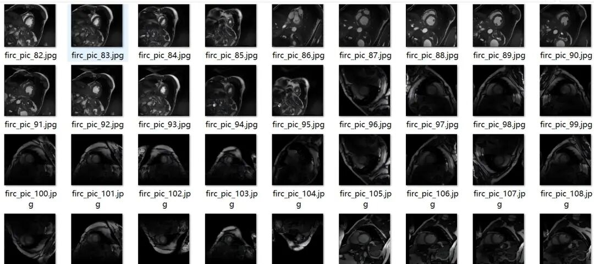
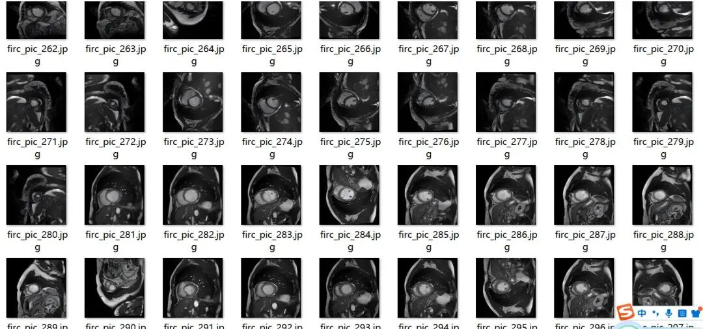
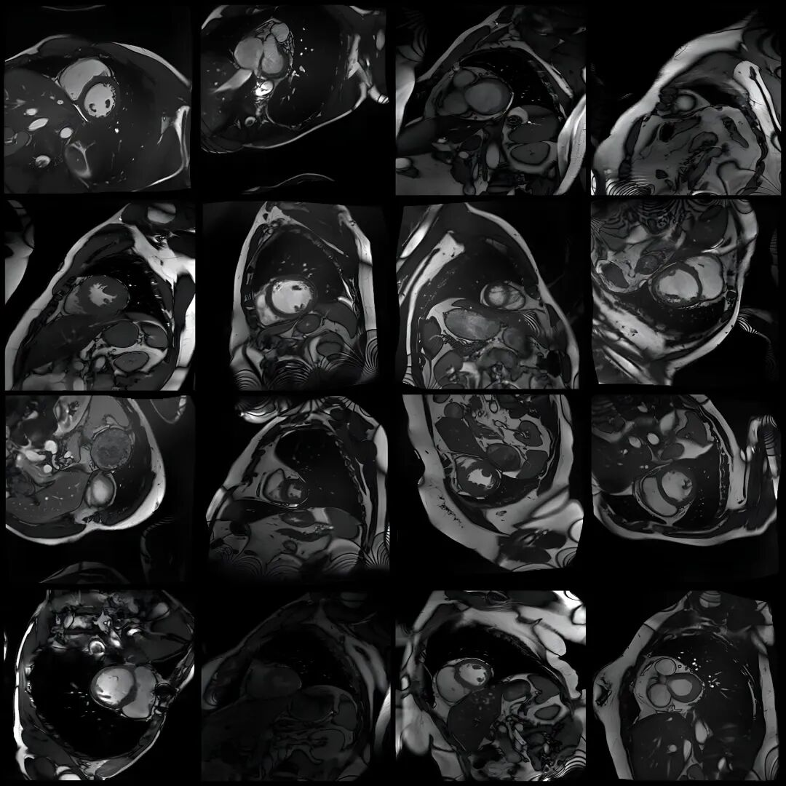
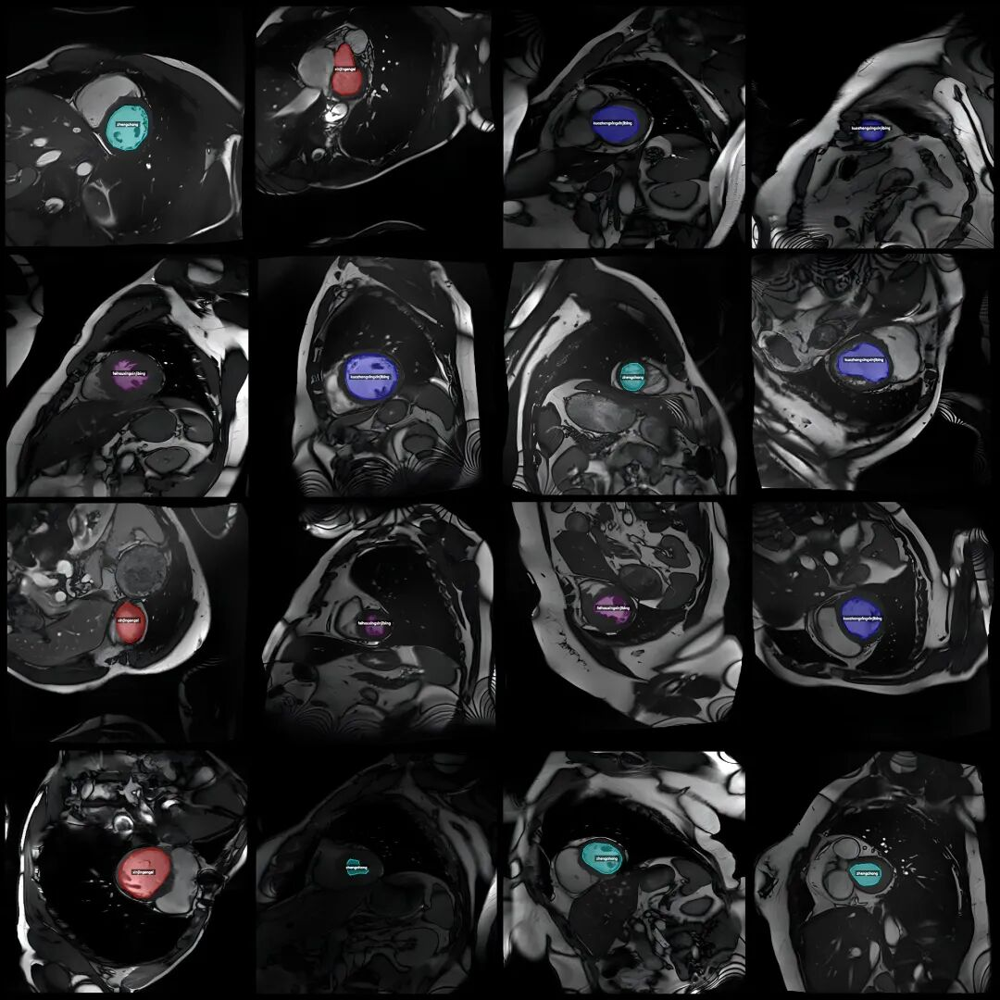
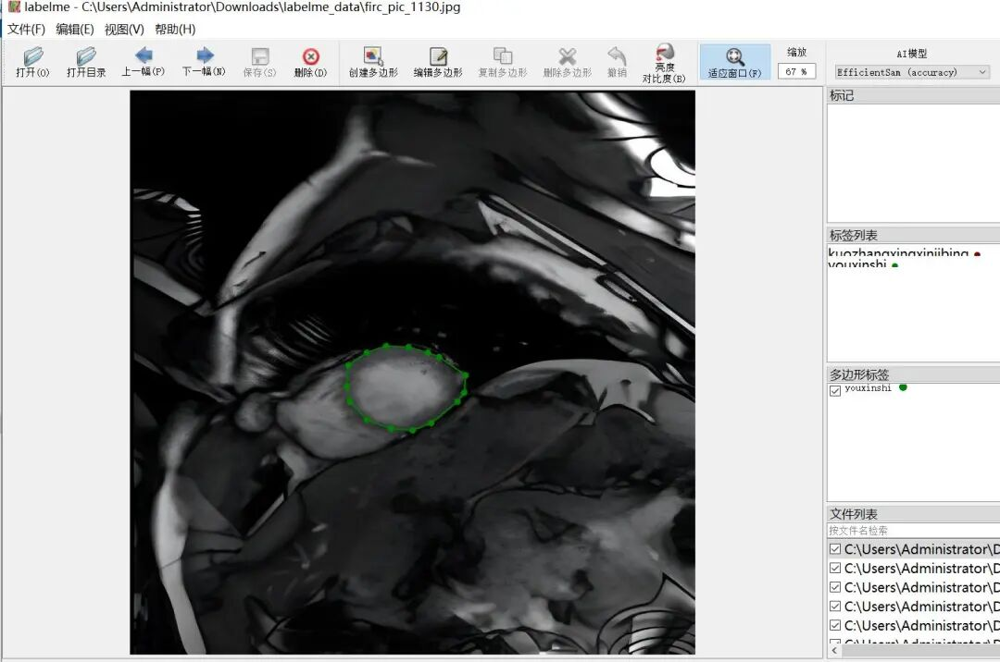

# Smart Healthcare ACDC Dataset: MRI Images of Myocardial Infarction, Extensive Cardiomyopathy, HCM, and Right Ventricular Lesions Identification and Segmentation Dataset in LabelMe format with 1147 images across 5 categories

Dataset format: labelme format (without mask files, only including jpg images and corresponding json files)

Number of images (number of jpg files): 1147

Number of annotations (number of json files): 1147

Label category count: 5

Annotation category names: ["feihouxingxinjibing", "kuozhangxingxinjibing", "xinjingengsi", "youxinshi", "zhengchang"]

Corresponding Chinese category name: ["Hypertrophic Cardiomyopathy", "Dilated Cardiomyopathy", "Myocardial Infarction", "Right Ventricular Diseases", "Normal"]

Number of boxes labeled in each category:

feihouxingxinjibing count = 304

kuozhangxingxinjibing count = 329

xinjingengsi count = 225

youxinshi count = 56

zhengchang count = 239

Total frame count: 1153

Using labeling tool: labelme=5.5.0

Image resolution: 1280x1280

Annotation rules: Draw polygons around the categories.

Important Notice: The dataset can be opened and edited using LabelMe. For JSON datasets, one must convert them into mask or Yolo formats for semantic segmentation or instance segmentation.

Special : This dataset does not guarantee the accuracy of the trained models or weight files.

Image Preview:

Annotation example:

Original image (pick 16 randomly):

Annotation:

LabelMe editing example:

## Payment

Here is a pay link on Stripe ( https://buy.stripe.com/3cs8yP7sY87d0vu9AB ). Please contact me lonlonago@foxmail.com after funding $89, and I will send you a complete data files , thank you!

